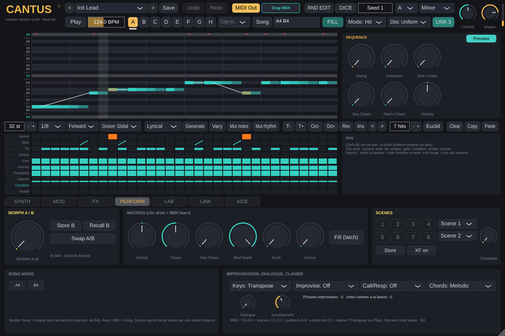

# ALEA SUITE : Alea (percussions) + Talea (basse) + Color (harmonie) + Cantus (mélodie)

Quatre instruments VST3 / AU (et applications autonomes) écrits en C++ avec JUCE 8 :

- **Alea v4** : le synthé de percussions aléatoire (8 voix, séquenceur façon TB-303 / Elektron).
- **Talea** : la basse, une TB-303 plus polyvalente avec le même hasard contrôlé.
- **Color** : l'instrument **harmonique**, un synthé 8 voix qui génère, joue et transforme des progressions d'accords selon les règles des six ouvrages de ton dossier « theorie musicale ».
- **Cantus** (nouveau) : la **mélodie**.
  - Synthé lead qui compose et **improvise des phrases sur les accords de Color** ;
  - il **dialogue avec la basse** de Talea.

Ouverts dans la même session, ils **se trouvent tout seuls** (AleaLink) et se synchronisent : tempo, lecture, tonique, gamme, pattern, fill, swing, scènes… et maintenant **la forme** (song mode).

Color publie ses accords et sa grille entière :
- **Talea** peut écrire une ligne de basse sur la grille, puis la suivre ;
- **Cantus** y construit ses mélodies ;
- **Alea** peut accorder ses percussions tonales sur l'accord en cours.



---

## 0. Nouveautés de cette version (v5)

**Correctif Cantus (v5.0.1)** : Cantus ne « mange » plus de notes.
- Une note qui en chevauchait une autre (swing, humanize, gate long) glissait sans être rejouée : on avait l'impression qu'elle manquait. Désormais elle est toujours rejouée, et seul un *slide* lie deux notes.
- Le *Dialogue* avec la basse retirait jusqu'à la moitié des notes qui tombaient en même temps que Talea. Il ne cède plus que de rares notes de passage.
- **Diagnostic des notes** (cadre PAS, à droite des couloirs).
  - Affiche toutes les 4 secondes combien de notes ont été jouées et combien ont été retirées, et par quoi : proba / condition, Density, Seq Chaos, Dialogue, Call & Response.
  - Passe en orange quand plus d'un quart des notes disparaissent.
- **Bouton « Jouer toutes les notes »** : remet Density à 50 %, Seq Chaos, Call & Response et Dialogue à zéro, et toutes les probabilités et conditions du pattern à 100 % (annulable).
- **Density en dessous de 50 %** : la mélodie garde son squelette. Les notes sur les temps et les accents restent, seules les autres disparaissent.

**Modes partagés (v5.0.4 / v5.0.5)** : le mode exact de Color est transmis aux autres instruments.
- La liste des gammes d'Alea, Talea et Cantus s'est enrichie : Dorian, Phrygian, Lydian, Mixolydian, Locrian, Harmonic minor, Melodic minor, Blues, Phrygian dominant, Lydian dominant, Diminished, Harmonic major, Hirajoshi.
- *Major* et *Minor* s'affichent désormais *Major (Ionian)* et *Minor (Aeolian)* : ionien et majeur sont la même gamme.
- Color en dorien → les autres jouent en dorien (avant : « mineur », donc une 6te fausse). Une gamme choisie dans un autre instrument met Color dans le mode correspondant.
- **v5.0.5** : les 38 gammes de Color existent maintenant aussi dans Alea, Talea et Cantus (Persian, Double harmonic, Hungarian, Neapolitan, Enigmatic, Altered, Bebop, Kumoi, In-sen, Pelog…). Chaque mode de Color arrive tel quel chez les autres.

**Tonalité partagée par Color (v5.0.3)** : les autres instruments suivent la tonalité **qui sonne** dans Color.
- Ce n'est plus seulement la tonique du haut de l'écran : la modulation *Key* du pattern en cours et la transposition de la chaîne Song (`A4+5`) comptent aussi.
- Quand Color module (Key +5, ou pattern B dans une autre tonalité), Talea, Cantus et Alea modulent avec lui.
- Une tonique changée dans un autre instrument est ramenée dans le repère de Color : par exemple, Color garde sa modulation de +5 et sonne dans la nouvelle tonalité.

**Color**
- **Modulations** :
  - chaque pattern a sa propre tonalité (réglage *Key* à côté de la grille) ;
  - la chaîne Song accepte une transposition : `A4 A4+5 B4` ;
  - LAB → **Moduler > pattern suivant** : copie la grille dans la nouvelle tonalité (+1, +2, +5, +7, relatifs, médiantes). La fin du pattern prépare l'arrivée par la dominante, par un ii-V, par un **accord pivot** commun aux deux tonalités, ou directement.
- **Voicing guitare** : de vraies positions d'accords sur 6 cordes en accordage standard.
  - Une position de 4 cases, cordes graves étouffées, cordes à vide qui résonnent.
  - La basse juste et la 3ce / 7e sont toujours présentes.
  - Idéal avec *Strum*.
- **Couches de son** (onglet SYNTH, *Layer*) : cloche FM, verre, souffle, octave, ajoutées à chaque voix (niveau et déclin réglables).
- **Harmoniser une mélodie** (LAB, ou glisser un .mid monophonique sur le plugin).
  - Color estime la tonalité, puis choisit la meilleure suite d'accords sur toute la mélodie, et non accord par accord.
  - Règles de Dobbins : notes de l'accord sur les temps forts, extensions permises (9e, 13e, 11e sur mineur), 9e mineure évitée, dominantes secondaires qui doivent résoudre.
  - Règles de Persichetti : enchaînements par quintes descendantes privilégiés, début et fin sur la tonique.
  - Un .mid d'accords est toujours analysé comme avant : Color reconnaît le type de fichier tout seul.
- **2 nouveaux styles** : *Neo Soul* (accords de 9e et 11e, iv mineur emprunté, V7#9, substitutions tritoniques) et *Bossa / Latin jazz* (changements tous les 2 temps, II7, ii-V avec demi-diminués, subV).
  - 2 presets associés : **Neo Soul Rhodes** et **Bossa Nylon**.
- **Rythme d'Alea** (LAB) : le rythme des accords est construit sur le pattern de la batterie liée, au choix :
  - entre les kicks ;
  - avec la caisse claire ;
  - sur le charleston.
- **Voice Spread** (SYNTH) : chaque voix a son propre caractère (filtre un peu plus ou moins ouvert, niveau), comme un vrai polyphonique analogique.

**Toute la suite**
- **Forme partagée** : LINK → *Song (forme)*.
  - L'instrument en song mode publie sa chaîne (par ex. A2 B2 = couplet / refrain).
  - Les autres changent de pattern en même temps, à la mesure près.
- **Talea → style « Color chords »** (générateur) : une ligne de basse écrite **sur la grille de Color**.
  - Fondamentale sur chaque changement d'accord ; tierce, quinte et octave de l'accord.
  - Notes d'approche vers la basse suivante (walking bass de Dobbins).
  - Le suivi *Root* est activé automatiquement.
- **Talea publie ses notes à l'avance** : Cantus s'en sert pour dialoguer avec la basse.

---

## 1. Installation

Les quatre plugins ont été compilés, validés (`auval`) et installés directement sur ton Mac (`~/Library/Audio/Plug-Ins/VST3` et `Components`). Dans Live : **Réglages → Plug-ins → Rescanner**, puis cherche **Cantus** dans les instruments.

Pour recompiler toi-même :

```bash
cd ~/Downloads/AleaSuite
cmake -B build -DCMAKE_BUILD_TYPE=Release -DALEA_JUCE_PATH=~/Downloads/Alea/build/_deps/juce-src
cmake --build build --config Release -j 8
```

- Prérequis : `xcode-select --install` et `brew install cmake`. Sans `ALEA_JUCE_PATH`, JUCE est téléchargé automatiquement.
- La commande construit les quatre plugins et les copie dans `~/Library/Audio/Plug-Ins/` (quitte Live avant).
- AleaLink passe en version 3 (grille, forme, Cantus) : **les quatre plugins doivent être de la même version**. C'est le cas de ceux installés.
- Les projets existants se rechargent ; les nouveaux réglages prennent leur valeur par défaut.

---

## 2. CANTUS en bref

Cantus reprend toute la base de Talea : synthé mono (8 oscillateurs, filtres, accent, glide, accords parallèles), piano roll et couloirs, hasard, modulateurs, effets, scènes, morph, LAB, export MIDI. Il est réglé pour le chant :
- registre plus haut ;
- glide en *Slide* = legato ;
- **vibrato** : profondeur, vitesse, et délai d'arrivée comme un chanteur ou une flûte.

### Le générateur de mélodies (règles des ouvrages lus)
- **Sur la grille de Color** (lue par AleaLink), ou sur la tonique et la gamme si Color n'est pas là.
- **Temps forts** : une note de l'accord.
- **Temps faibles** : notes de passage et broderies dans la **gamme de l'accord**, la gamme parente de Russell.
  - En bebop : chromatismes de passage (Dobbins).
- **Contour en arche** : la phrase monte vers un sommet puis redescend (Persichetti).
- **Saut compensé** : après un grand saut, mouvement conjoint en sens contraire.
- **Cadence** : la phrase se termine sur la fondamentale ou la quinte, note tenue.
- **9 styles** : Lyrique (notes longues, legato), Motif (un motif répété en **séquence** sur chaque accord), Arpège, Pentatonique (sans les demi-tons qui frottent avec l'accord), Bebop, Riff, Épuré, Grands sauts, Aléatoire.
- **LAB** :
  - *Mélodie (Color)* : génère sur la grille ;
  - *Développer* : même rythme, séquence d'un degré et variations.

### Le suivi des accords (*Chords*, onglets PERFORM et LINK)
- **Melodic** (par défaut) : temps forts ramenés sur une note de l'accord en cours, temps faibles dans sa gamme. N'importe quelle mélodie, même dessinée à la main, reste juste quand Color change d'accord.
- **Chord tones** : toujours une note de l'accord.
- **Scale** : toujours dans la gamme de l'accord.

### Improvisation et dialogue (onglet PERFORM)
- **Improvise** (1, 2, 4 ou 8 mesures) : à chaque phrase, une nouvelle phrase remplace la précédente.
  - Elle est préparée à l'avance, puis échangée pile sur la mesure.
  - *Development* dose le choix : bas = la phrase précédente est **développée** (même rythme, séquence, variations) ; haut = idée nouvelle.
- **Dialogue** : Cantus lit les notes de Talea à l'avance et laisse passer quelques attaques de la basse.
  - Il ne cède que des notes de passage (doubles croches faibles), jamais sur un temps ou un demi-temps, et au plus une note par temps.
  - Réglé par défaut à 25 %, ce qui donne environ 4 % de notes cédées ; 0 % pour jouer toutes les notes.
  - Le compteur « notes cédées à la basse » de l'onglet PERFORM montre ce qui a été laissé.
- **Call / Response** : la mélodie joue une phrase et se tait la suivante, laissant la réponse aux autres.
- Les compteurs de phrases improvisées et de notes cédées sont affichés.

### Presets
Init Lead, Singing Saw, Soft Flute, Square Chip, FM Bell Lead, Pluck Melody, Anthem Supersaw, Bebop Synth, Fold Whistle.

Les rendus sont dans `demos/`, avec **`quatuor_alea_talea_color_cantus.mp3`** : les quatre instruments liés, basse et mélodie générées sur la grille de Color.

---

## 3. COLOR en bref

### Ce qui a été lu, et ce qui en a été tiré

Les 6 PDF du dossier « theorie musicale » ont été lus en entier (par reconnaissance de texte, page par page). Les exemples en notation musicale ne sont pas lisibles comme du texte : ce sont les explications qui ont servi.

| Ouvrage | Ce que Color en fait |
|---|---|
| **George Russell** – *Lydian Chromatic Concept of Tonal Organization* | La **gravité tonale** : chaque accord a une *tonique lydienne* et une **gamme parente** (lydien, lydien augmenté, lydien diminué, auxiliaires…). L'ordre lydien chromatique mesure si l'on est *ingoing* (près du centre) ou *outgoing*. Utilisé pour : l'arpège *Lead* (mélodie dans la gamme parente), le potard **Outgoing**, l'indicateur *Gravité*, le style **Lydien (Russell)**. |
| **Vincent Persichetti** – *Twentieth-Century Harmony* | **Tension** d'un accord d'après ses intervalles (secondes mineures, tritons > tierces > quintes). **Cycles de fondamentales** (quintes, tierces, secondes : réglage *Root Cycle*). Accords par quartes, clusters, polyaccords, accords à notes ajoutées. **Planing** (style impressionniste), pédales, pandiatonisme, cadences, modes rangés du plus sombre au plus clair. |
| **Frank Dobbins** – *Jazz Piano Harmony* | Les **voicings** : position serrée, drop 2, drop 2+4, shells (3-7), rootless A/B, upper structures, quintes, quartes. Les **règles** : 3ce et 7e toujours présentes, pas de 9e mineure entre deux voix, pas d'intervalles serrés dans le grave, doublures évitées, mouvement minimal. L'**harmonisation d'une mélodie** (mode clavier *Harmonize*). Le comping, le blues, le gospel, les rythmes latins. |
| **Mike LaVerne** – *Reharmonization* | Les **12 techniques de réharmonisation** : substitution tritonique, dominantes secondaires, ii-V insérés, accords d'approche, changement de qualité, substitut relatif, sus, diminués de passage, backdoor, médiantes, structure constante, pédale. Accessibles par le bouton *Reharm*, le menu de chaque accord, la dose (LAB) et **en direct** (*Live Sub*, *Approach*). |
| **Joseph Boss** – *Schoenberg's Twelve-Tone Music* | Le style **Atonal (set classes)** : accords-ensembles (4-19, 016, hexacorde 6-20), invariance, circulation des 12 sons (aucune classe de hauteur ne revient avant que les autres aient sonné), et les « fantômes de tonalité » quand la tension baisse. |
| **Kadmon** – grimoires de gammes et d'accords | Le **catalogue de 38 gammes** (modes, mineurs mélodique et harmonique, symétriques, pentatoniques, bebop, exotiques), la compatibilité gamme/accord, les polyaccords et accords slash. |

### La progression (zone du haut)

- **Bandeau de progression** : un bloc par accord, sa largeur suit sa durée.
  - Chaque bloc affiche le nom, le **degré** (ii7, V7/ii, bVImaj7, iiø7…) et la **fonction** : T (tonique), S (sous-dominante), D (dominante), C (couleur / chromatique).
  - La barre rouge à gauche indique la tension.
  - **Clic** = écouter. **Glisser le bord droit** = changer la durée.
  - **Clic droit** = menu : substitutions proposées, les 12 réharmonisations, qualité (41 qualités), fondamentale, renversement, basse (slash chord), durée, « accord suivant probable », dupliquer / supprimer.
- **Saisie texte** : tape une grille et valide par Entrée.
  - Exemple : `Am9 Fmaj7 C/E G6`, ou `Dm7:2 G7:2 Cmaj7` (`:N` = durée en temps).
  - Le texte se met à jour quand tu modifies la grille autrement.
- **Barre d'outils** :
  - *Style* + *Generate* ;
  - *Reharm* (technique choisie, sur un accord au hasard) ;
  - *Vary* : couleurs, fondamentales gardées ;
  - *Simplify* / *Enrich* ;
  - *T- / T+* : transposition **diatonique**, les qualités suivent le mode ;
  - rotation, *Rev* ;
  - *Cadence* : parfaite, plagale, rompue, demi-cadence, backdoor, modale.
- **14 styles** :

  | Style | Ce qu'il génère |
  |---|---|
  | Pop | — |
  | Fonctionnel | T-S-D, dominantes secondaires |
  | Jazz II-V | — |
  | Modal | accords caractéristiques du mode |
  | Cinématique | médiantes, accords ajoutés |
  | Techno / Deep | m7, m9, quartes, peu d'accords |
  | Gospel / Soul | accords de passage |
  | Blues | 12 mesures |
  | Impressionniste | planing |
  | Atonal | set classes |
  | Lydien (Russell) | — |
  | Aléatoire | — |
  | Neo Soul | 9e / 11e, iv mineur, V7#9 |
  | Bossa / Latin jazz | 2 temps par accord, II7, subV |

- **Onglet HARMONIE** :
  - *Complexity* : triades → 13e.
  - *Tension* : altérations, emprunts.
  - *Chroma* : substitutions chromatiques.
  - *Root Cycle* (Persichetti), nombre d'accords, durée par accord.
- **Mode** (en haut, à côté de la tonique) : 38 gammes.
  - Les autres instruments reçoivent l'équivalent simplifié : majeur, mineur, penta…
  - Inversement, si Alea ou Talea change de gamme, Color garde son mode s'il est compatible.

### Les voicings et la conduite des voix

- **Voicing** :
  - *Close*, *Drop 2*, *Drop 2+4*, *Spread*, *Shell*, *Rootless A / B*, *Quartal*, *Upper struct.*, *Cluster*, *Fifths* ;
  - *Auto* : choisit selon la qualité de l'accord et la complexité.
- **Réglages** :
  - *Voices* : 2 à 7 voix, plus la basse.
  - *Register* : centre du voicing.
  - *Spread* : écartement.
  - *Voice Lead* : poids du plus petit mouvement entre deux accords ; les notes communes restent en place.
  - *Bass* : Off, Root/Inv (fondamentale, renversement ou slash), Pedal (tonique tenue sous tout).
- **Glide: Voice lead** (onglet SYNTH) : les voix **glissent** d'un accord au suivant. La conduite des voix devient audible, très beau sur les nappes.
- **Le clavier** de droite montre :
  - les notes jouées (la basse en orange) ;
  - les notes de la gamme parente de l'accord, en points (violet = note de l'accord).
- **Tension et Gravité** de l'accord en cours sont affichées à côté.

### Le jeu et le rythme

- **Play mode** :
  - **Pad** : accords tenus, notes communes conservées ; le rythme est ignoré.
  - **Comp** : accords sur les coups du rythme.
  - **Strum** : accords grattés, alternance haut/bas, réglage *Strum*.
  - **Arp** : Up, Down, Up-Down, Random, ou **Lead** (mélodie improvisée dans la gamme parente de chaque accord), sur 1 à 3 octaves.
- **Grille rythmique** :
  - Clic = coup ; glisser = durée tenue ; Maj = accent ; Cmd-clic = p-locks ; clic droit = menu.
  - Couloirs : Velocity, Gate, Proba, **Partie** (tout / note du haut / basse seule / sans basse), Strum (global / montant / descendant), Octave, Ratchet, Condition, Nudge.
- **10 rythmes prédéfinis** : ronde, noires, contretemps, charleston, clave 3-2, anticipations, arpège en doubles, house chops, euclide, aléatoire.
  - *Gen rhythm* choisit un rythme idiomatique du style (comping jazz, house, gospel…).
- **En direct**, sans modifier la grille :
  - **Live Sub** : substitutions tirées à chaque passage (triton, couleurs, altérations).
  - **Approach** : accord d'approche sur le dernier temps (subV, dominante, diminué).
  - Ils s'affichent en jaune sur la progression.
- **Voic. Chaos** : déplace ou omet des notes du voicing au vol.

### Le clavier MIDI (à partir de C2)

- **Transpose** : C3 = rien.
- **Chord select** : les touches blanches depuis C3 jouent les accords 1, 2, 3… de la grille.
- **Harmonize** : la note jouée est harmonisée (note de l'accord, extension ou nouvel accord diatonique qui la contient).
- **Play** :
  - une touche = accord diatonique du degré ;
  - plusieurs touches = accord reconnu (D F A C → Dm7).
  - Cet accord est publié à Talea et Alea comme les autres.
- C0-G0 = scènes, C1-G1 = patterns A-H.

### THEORIE, LAB et le reste

- **THEORIE** : analyse de la grille.
  - Pour chaque accord : degré, fonction, tension, gravité, gamme parente et ses notes.
  - Cycle des quintes avec le chemin de la progression.
  - Bilan des mouvements de fondamentale (quintes / tierces / secondes).
  - Boutons **« suite probable »** pour l'accord choisi (clic = insérer).
- **LAB** :
  - réharmonisation dosée, générer les 8 patterns, durées uniformes ;
  - favoris de sons + croisement ;
  - **évolution** non destructive : coups qui basculent, accords substitués au fil des mesures, son qui dérive ; *Commit* / *Reset* ;
  - croisement de patterns ;
  - **analyse d'un fichier MIDI** (ou glisser un .mid sur le plugin) : tonalité estimée (Krumhansl), accords reconnus temps par temps ;
  - export MIDI.
- **SYNTH** :
  - la même architecture que Talea, en 8 voix sur-échantillonnées : 8 oscillateurs dont SuperSaw, Fold, Pluck ; osc 2 + FM ; sub ; 6 filtres ; 5 saturations.
  - *Vel>Filt* (la vélocité ouvre le filtre), *Width* (stéréo des voix), *Voice Drift* (désaccord analogique par voix).
- **MOD, FX, PERFORM** : comme Talea.
  - Modulateurs, matrice 8 slots ; nouvelles cibles *Tension*, *Complexity*, *Spread*, *Register*, *Live Sub*.
  - Chorus, delay, plate, sidechain par Alea.
  - Morph A/B, scènes, song mode, macros.
- **14 presets d'usine** : Init Pads, Neo Soul Keys, Deep House Stabs, Cinematic Strings, Gospel Organ, Lydian Glass, Impressionist Planing, Blues Comp, Dub Techno Chord, Atonal Clusters, Arp Dreams, Strum Guitar, Neo Soul Rhodes, Bossa Nylon.
  - Les rendus sont dans `demos/`, avec `trio_alea_talea_color.mp3` (les trois instruments liés).
- **Drag MIDI** (en haut) : glisse 8 mesures de ce que joue Color vers une piste MIDI. *MIDI Out* envoie les notes en direct.

---

## 4. TALEA en bref

### Le son (onglet SYNTH)
- **Oscillateur 1**, 8 formes :
  - Saw, Square et Pulse (anti-repliement PolyBLEP) ;
  - Triangle et Sine ;
  - SuperSaw ;
  - Fold (repliement d'onde) ;
  - Pluck (corde Karplus-Strong).

  Le potard **Shape** change de rôle selon la forme : largeur d'impulsion, désaccord, repliement ou amorti.
- **Oscillateur 2**, avec désaccord en demi-tons et en cents et une **FM** vers l'osc 1.
- **Sub** (sinus ou carré à -1 octave, sinus à -2) et **bruit**.
- **Filtre** au choix :
  - *303 Diode*, filtre à diodes non linéaire ;
  - *Ladder 24 dB*, façon Moog ;
  - SVF passe-bas, passe-bande ou passe-haut ;
  - Off.

  Réglages : Resonance, Env Mod, F.Decay, Key Track, F.Drive.
- **Accent 303** : l'accent ouvre le filtre, raccourcit sa décroissance et **s'accumule** sur les accents rapprochés (le « wow » de la 303).
- **Enveloppe d'ampli** ADSR, **Glide** (Slide seulement, Always ou Off), **accords paraphoniques** (octave, quinte, mineur, majeur, sus4, min7, maj7).
- **Saturation de sortie** : Soft, Hard, Fold, Tube ou Crush.
- **Moteur** : tout est calculé en suréchantillonnage x2. Les potards agissent **en continu sur la note tenue** : on peut tourner le cutoff pendant un slide.

### Le séquenceur (piano roll + couloirs)
- 8 patterns (A–H) de 1 à 32 pas, 25 notes (deux octaves au-dessus de la tonique), lignes de la gamme surlignées.
- **Piano roll** :
  - clic = poser ou effacer une note, glisser = dessiner ;
  - **Maj** = accent ;
  - **Cmd-clic** = p-locks du pas ;
  - clic droit = menu du pas ;
  - Alt-clic = longueur du pattern.
- **Couloirs** :
  - Accent, **Slide** (glisse vers la note suivante, porte tenue), **Tie** (prolonge sans redéclencher), Octave ;
  - Gate, Velocity, Probability, Ratchet ;
  - Condition (1:2, Fill, PRE, NEI…), Nudge.
- Sens de lecture, grooves (MPC, shuffle…), subdivisions, swing, humanize.
- **Hasard de séquence** :
  - *Note Chaos* change des notes au vol, toujours dans la gamme, sans toucher au pattern ;
  - *Density* ajoute ou retire des notes fantômes ;
  - *Seq Chaos* et *Ratch Chaos*.
- **Aperçu** de la mesure à venir : point turquoise = note fantôme, trait rouge = pas qui sautera.

### Le hasard (comme Alea)
- Chaque potard a son **anneau d'aléa** : clic droit-glisser, Cmd-glisser ou **RND EDIT**.
- **Mode** : Hit (chaque note), Bar (chaque mesure) ou Drift (dérive lente). **Dist** : Uniform, Gauss ou Rare. **Rnd Link** corrèle les paramètres entre eux.
- **CHAOS** dose tout l'aléa, et la **Seed** le rend reproductible : le même réglage rejoue exactement pareil, bounce compris.
- **Dé** sur le son (cadenas = paramètre protégé, *Dice + Types* change aussi oscillateurs et filtre), Mutate, Rnd amounts, Zero rnd, **Keep** (fige la dernière note jouée).

### Générateur de lignes (barre d'outils + onglet LAB)
- 9 styles :
  - Acid, Rolling, Driving 8ths, Dub, Arp, Euclid, Random ;
  - **Follow kick** (sur les kicks d'Alea) et **Avoid kick** (entre les kicks).
- Réglages : densité, ambitus, accents, slides, sauts d'octave, poids de la tonique.
- *Notes only* et *Rhythm only* régénèrent une seule moitié.
- **Outils** :
  - Vary (variation apprise du pattern, chaîne de Markov), Mut notes, Mut rhythm ;
  - **T- / T+** (transposition par degrés de la gamme), Oct-/Oct+ ;
  - Rev, **Inv** (miroir mélodique), décalages, Euclid ;
  - copier / coller, copie vers un autre pattern.
- **Style appris** : glisse un `.mid` de basse sur le plugin. Talea apprend rythme, accents, slides, intervalles et degrés, puis génère dans ce style.

### Modulation (MOD), effets (FX), jeu (PERFORM), labo (LAB)
- **Modulation** :
  - 6 modulateurs aléatoires : S&H, Smooth, Turing, Chaos, LFO, et **Drums**, une enveloppe déclenchée par une piste d'Alea ;
  - matrice de 8 slots vers tous les paramètres et des cibles globales (delay, reverb, densité, chaos, swing, duck…).
- **Effets** :
  - chorus, delay (ping-pong, temps aléatoire), réverbe plate, Glue, drive master ;
  - **sidechain par Alea** : le kick d'Alea fait pomper la basse, calé au sample près parce que les coups sont connus à l'avance.
- **Jeu (PERFORM)** :
  - Morph A/B, 8 **scènes** avec crossfader, macros (clic droit = MIDI learn), Fill ;
  - song mode (chaîne `A4 B4…`) ;
  - clavier : **Transpose** (comme la 303 : une note transpose la ligne, C3 = rien) ou **Play** (la basse joue ce que tu joues, legato = slide).
- **Labo (LAB)** :
  - favoris + Breed (croisement de sons) ;
  - **évolution automatique** non destructive : notes qui changent de degré, pas qui basculent, son qui dérive, puis *Commit* ou *Reset* ;
  - croisement de patterns.
- **MIDI** :
  - entrées : C0–G0 = scènes, C1–G1 = patterns, à partir de C2 = clavier ;
  - CC : MIDI learn ;
  - **sortie MIDI** des notes (slides en legato) ;
  - **Drag MIDI** : glisse 4 mesures vers une piste de Live.
- **Presets** : 9 presets d'usine, chacun avec 8 patterns et 4 scènes (Init Acid, Rubber Acid, Reese, Sub Dub, FM Growl, Pluck Bass, Rolling Techno, Hoover Chords, Euclid Fold). Presets utilisateur dans `Documents/Talea/Presets`.
- Undo / redo, interface redimensionnable.

---

## 5. AleaLink : la synchronisation automatique

Chaque instance d'Alea, de Talea, de Color ou de Cantus s'annonce dans une petite mémoire partagée (`~/Library/Application Support/AleaLink`). L'onglet **LINK** (et le bouton LINK de la barre du haut, qui affiche le nombre d'instances liées) montre :
- les instances détectées, avec leur tempo, état, pattern et tonique ;
- les cases de ce qui est synchronisé.

| Synchronisé par défaut | En option |
|---|---|
| Tempo, Lecture (Play/Stop), Tonique, Gamme, Pattern, Fill, Swing, Scène, **Song (forme)** | Chaos, Evolve, Density, Morph, Seed |

- **Qui gagne ?**
  - La dernière instance qui modifie une valeur cochée la transmet aux autres, dans les deux sens.
  - Une instance ouverte seule devient la référence ; une instance qui rejoint un groupe adopte ses valeurs.
  - Décocher une case (ou *LINK actif*) rend l'instance indépendante sur ce point.
- **Dans Live**, le tempo et la position viennent de Live : tout est déjà calé. Hors DAW (applications autonomes, ou bouton Play interne avec le transport arrêté), *Play* et le tempo sont partagés et les instances suivent une **horloge commune**.
- **Ce qu'Alea envoie** :
  - ses coups des 2 temps à venir : sidechain sans latence et modulateur *Drums*, pour Talea **et Color** ;
  - le pattern de chaque piste (générateurs *Follow kick* / *Avoid kick* de Talea).
- **Ce que Color envoie** :
  - l'accord en cours et les prochains changements (avec les substitutions en direct), avec la **gamme de chaque accord** ;
  - la **grille complète** du pattern (générateurs de Talea et Cantus) ;
  - l'accord joué au clavier quand le transport est arrêté.
- **Ce que Talea envoie** : ses notes des 2 temps à venir (*Dialogue* de Cantus).
- **La forme** : l'instance en song mode publie sa chaîne. Les autres, avec LINK → *Song* coché (par défaut) et leur propre song mode éteint, jouent le même pattern à la même mesure.
- **Talea → onglet LINK → Chord follow** :
  - *Root* : la ligne de basse est transposée sur la basse de l'accord ; les notes qui frotteraient d'un demi-ton glissent sur la note de l'accord.
  - *Chord tones* : chaque note de basse devient une note de l'accord.
- **Alea → onglet LINK → « Key lock = accords de Color »** : avec Key lock actif, les voix tonales (FM, Modal, Pluck, et en *All* Kick, Snare, 909) jouent les notes de l'accord en cours.
- **Petite subtilité** : la gamme « Scale: Off » d'Alea ne signifie rien pour une basse ou des accords, donc Talea et Color gardent la leur tant qu'Alea n'en choisit pas une.

---

## 6. Organisation du code

```
AleaSuite/
  CMakeLists.txt        les quatre plugins + bancs de test
  Shared/               commun aux instruments
    Core.h              hasard deterministe, gammes, subdivisions, conditions
    DSP/                effets (delay, plate, glue...) et modulateurs aleatoires
    Gui/                potard RndKnob, scope, onglet LINK, couleurs
    Link/AleaLink.*     memoire partagee v3 : synchro, horloge, coups, accords, grille et forme publies
  Alea/Source/          percussions (v4)
  Talea/Source/         basse
  Color/Source/
    ColorTheory.*       LE MOTEUR HARMONIQUE : 38 gammes, 41 qualites, fonctions, tension (Persichetti),
                        gravite / gammes parentes (Russell), 14 styles de progressions, harmonisation de melodie, 12 reharmonisations
                        (LaVerne), voicings et conduite des voix (Dobbins), harmonisation, reconnaissance
    ColorCommon.*       parametres
    ColorPattern.h      pas rythmiques, progression (16 accords), banque
    ColorSequencer.h    sequenceur rythmique
    DSP/ColorVoice.h    voix (x8, sur-echantillonnee)
    ColorProcessor.*    moteur : allocation des voix, Pad/Comp/Strum/Arp, clavier, substitutions, AleaLink
    ColorGenerators.cpp progressions, transformations, rythmes, sons, presets, analyse / export MIDI
    Gui/ChordWidgets.*  progression, grille rythmique, clavier, onglet THEORIE
    ColorEditor.*       interface
  Cantus/Source/        melodie : base de Talea + generateur de melodies (CantusGenerators.cpp),
                        suivi Melodic, improvisation, dialogue (CantusProcessor.cpp), vibrato (DSP/LeadVoice.h)
  Tests/                AleaTest.cpp, TaleaTest.cpp, ColorTest.cpp, CantusTest.cpp, ColorTheoryProbe.cpp
  docs/                 captures
  demos/                rendus audio
```

## 7. Tests

```bash
cmake -B build -DALEA_BUILD_TESTS=ON && cmake --build build --target AleaTest TaleaTest ColorTest CantusTest
./build/ColorTest_artefacts/Release/ColorTest && ./build/CantusTest_artefacts/Release/CantusTest
```

**ColorTest** (77 vérifications, toutes au vert, aussi sur ton Mac) :
- **Théorie** :
  - 2 240 progressions générées (14 styles) toutes valides ;
  - harmonisation d'*Au clair de la lune* : tonalité trouvée (do), notes des temps forts dans l'accord, début sur la tonique ;
  - le style fonctionnel part de la tonique ; le jazz contient des dominantes ; le blues fait 12 mesures ;
  - sur 6 230 voicings, les règles de Dobbins sont tenues : 3ce et 7e présentes à 98 %, aucune 9e mineure, rien de serré dans le grave ;
  - mouvement moyen par voix d'environ 2,4 demi-tons ;
  - reconnaissance d'accords.
- **Édition** : saisie texte, transposition diatonique aller-retour, 12 réharmonisations, triton G7 → Db7, cadences, Simplify / Enrich.
- **Jeu** :
  - en Pad, Comp, Strum et Arp, **100 % des notes jouées appartiennent à l'accord en cours** ;
  - notes communes conservées ; strum étalé ;
  - clavier (Chord select, Play : E → Em, D F A C → Dm7, Harmonize) ;
  - Live Sub / Approach sans toucher la grille.
- **Fonctions** : presets, reproductibilité, évolution, export puis ré-analyse MIDI (mêmes fondamentales), état complet, undo, presets.
- **Robustesse** : CPU (8 voix SuperSaw : 7,7 % d'un cœur sur ton Mac), fuzz (3 fréquences × 6 tailles de bloc).
- **AleaLink** :
  - Color détecte Alea et Talea ; mode dorien → gamme mineure chez Talea ; tonique partagée ;
  - Play de Color lance les deux autres ; horloge commune ;
  - **Talea en *Chord tones* : 100 % de ses notes dans l'accord de Color** ;
  - Alea reçoit l'accord.

- **Nouveautés** :
  - voicing guitare : 48/48 positions valides (4 à 6 cordes, fondamentale à la basse, 3ce présente) ;
  - modulations : dominante → `C Am F C7` puis `F Dm Bb C` ; accord pivot ;
  - chaîne `A1 A1+5` : la 2e mesure sonne en fa ;
  - 5 couches de son.

**CantusTest** (20 vérifications) :
- **Seul** :
  - 9 styles de mélodie dans la gamme, cadence sur la tonique ou la quinte, ambitus raisonnable ;
  - vibrato, 9 presets ;
  - Improvise (une phrase par mesure) ; Call & Response (silence une mesure sur deux) ;
  - état, fuzz.
- **En quatuor** :
  - les 4 instruments se voient ; tonalité partagée ;
  - Cantus lit la grille de Color ;
  - **100 % des notes des temps forts de Cantus dans l'accord**, et 100 % de ses notes dans la gamme de l'accord ;
  - **Talea « Color chords » : la basse de l'accord sur chaque changement** ;
  - Dialogue (notes cédées à la basse) ;
  - **forme partagée** : Talea, Cantus et Alea suivent la chaîne A2 B2 de Color à chaque mesure.

**TaleaTest** et **AleaTest** passent toujours en entier.

## 8. Limites connues
- AleaLink relie les instances **d'une même machine** (pas de réseau).
- Hors DAW, l'horloge commune se recale quand l'écart dépasse environ 30 ms : une lecture déjà lancée peut faire un petit saut à l'arrivée d'une autre instance.
- Color : 8 voix maximum (basse comprise) ; 16 accords par pattern (8 patterns + song mode pour des grilles plus longues).
- Cantus et Talea : un pattern fait au plus 32 pas. Une grille de plus de 16 temps est couverte en croches ; au-delà, la ligne boucle plus tôt que la grille, mais le suivi des accords la garde juste.
- Dialogue et Improvise s'entendent quand le transport tourne (dans Live ou avec Play).
- Les exemples en notation musicale des PDF n'ont pas pu être lus (seulement le texte).
- Le format CLAP reste optionnel et non testé (`-DALEA_CLAP=ON`).
