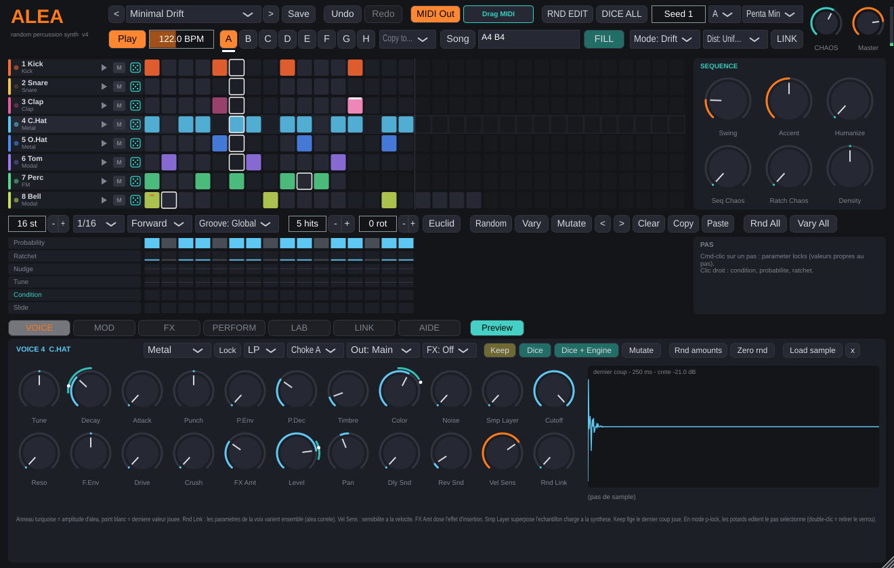

# ALEA v3 : synthé de percussions électroniques aléatoire

Instrument virtuel VST3 / AU (et application autonome) écrit en C++ avec JUCE 8.
Il réunit 8 voix de synthèse de percussion, un séquenceur façon TB-303 / Elektron et du hasard partout : dans le son, dans la séquence, dans les effets et dans la modulation.



---

## 1. Compiler sur macOS

Les étapes sont les mêmes que pour la v1. Si tu as déjà compilé la v1, remplace le dossier `Alea` par celui-ci et relance les deux commandes.

```bash
cd ~/Downloads/Alea
cmake -B build -DCMAKE_BUILD_TYPE=Release
cmake --build build --config Release -j 8
```
Prérequis : `xcode-select --install`, puis `brew install cmake`. JUCE est téléchargé automatiquement.

Le VST3 et l'AU sont copiés dans `~/Library/Audio/Plug-Ins/`. Dans Live : **Réglages → Plug-ins → Rescanner**.

> Si Live garde l'ancienne version en mémoire, quitte Live avant de compiler, puis relance-le.
> Les projets Live enregistrés avec la v1 se rechargent (patterns et réglages), mais quelques nouveaux paramètres reprennent leur valeur par défaut.

---

## 2. Nouveautés de la v3

### Garder les bons tirages (onglet LAB)
- **Keep** (aussi dans VOICE) : recopie dans les potards les valeurs réellement jouées au dernier coup, aléa et modulations compris. Un coup réussi devient le nouveau son de base.
- **Favoris** : 8 cases par voix. Une case vide mémorise le son, une case pleine le rappelle et le fait entendre. Maj-clic écrase une case.
- **Breed** : croise deux favoris. Chaque paramètre vient d'un parent, tiré vers l'autre, avec une petite mutation.

### Évolution automatique (LAB)
- Toutes les N mesures, des pas basculent et les sons dérivent, avec une intensité réglée par **Evolve** (macro mappable sur Push et en MIDI).
- C'est **non destructif** : dans la grille, un contour pointillé marque un pas ajouté, une barre un pas retiré.
  - **Commit** écrit le résultat dans le pattern et les potards (annulable).
  - **Reset** revient à l'origine.
- **Croisement de patterns** : chaque piste prend le début d'un pattern et la fin d'un autre.

### Style appris d'un fichier MIDI (LAB)
- *Learn MIDI file…* (ou glisser un `.mid` sur le plugin) : Alea apprend où tombent les coups de chaque instrument (mapping General MIDI), mesure par mesure.
- *Style > track* et *Style > all* génèrent ensuite des patterns de 16 pas dans ce style.

### Sidechain et effets par voix
- **Sidechain** (onglet FX) : une piste (le kick par défaut) fait « pomper » toutes les autres, avec un réglage d'intensité et de relâchement.
  Une piste **muette** peut servir de source : c'est un « kick fantôme » qui fait pomper le mix sans s'entendre.
- **Effet d'insertion par voix** (*FX: Fold / Comb / Ring / Tape*), dosé par le nouveau potard **FX Amt** (avec son propre aléa) :
  - Fold : repliement d'onde ;
  - Comb : filtre en peigne accordé sur la voix ;
  - Ring : modulation en anneau ;
  - Tape : saturation de bande.
- **Smp Layer** : superpose l'échantillon chargé à la synthèse, par exemple un kick synthé avec un sample de transitoire.
- **Réverbe Plate** : réseau de retards à 8 lignes, avec predelay. L'ancienne reste disponible sous le nom *Room*.
- **HQ x2** : les voix sont calculées en double fréquence d'échantillonnage puis filtrées, pour moins de repliement sur FM, Zap, Metal et le drive.

### Le côté 303 : slide et clavier
- **Slide** sur un pas : la hauteur glisse depuis le coup précédent de la piste. Il se règle dans le couloir *Slide*, par clic droit, ou avec *Slide time* dans PERFORM.
- **Mode clavier** (PERFORM → *Keys*) : les notes MIDI à partir de C3 jouent la voix choisie de façon chromatique. Le jeu legato produit un slide.

### Scènes (PERFORM)
- 8 mémoires de sons pour les 8 voix. Clic = rappel, Maj-clic (ou *Store* puis clic) = mémoriser. Notes MIDI **C0 à G0** = rappel.
- **Crossfader** entre la scène A et la scène B (*XF on*). Chaque preset d'usine fournit 4 scènes : le son d'origine, puis trois variations de plus en plus éloignées.

### Modulation étendue (MOD)
- 2 nouvelles sources :
  - **LFO** : sinus, triangle, scie, carré ou paliers aléatoires selon *Shape* ;
  - **Follow** : suiveur d'enveloppe d'une piste (par exemple, le kick module le filtre des charleys).
- **Cibles globales** dans la matrice (`G:…`) : feedback, tonalité et retour du delay, taille et retour de la réverbe, Density, Chaos, Seq Chaos, Ratch Chaos, Stutter, Swing, Duck, Master Drive, Evolve. Ces cibles sont modulées **en continu**.

### Séquenceur
- **Conditions PRE / !PRE** (si le dernier pas conditionnel de la piste a joué) et **NEI / !NEI** (selon la piste voisine du dessus).
- **Groove par piste** : *Global* (swing général), *Straight*, *MPC 54/58/62/66 %*, *Shuffle*, *Laid back*, *Push*.
- **Nouvelles subdivisions** : 1/4, 1/8T, **1/16 x5** (quintolets), **1/16 x7**, 1/32T, pour des polyrythmes 5:4, 7:4…
- **Aperçu** (bouton *Preview*) : la grille montre ce que la mesure à venir va réellement jouer.
  - Point turquoise : coup fantôme ajouté par le chaos ou la densité.
  - Trait rouge : pas qui sautera (probabilité, condition, chaos).

### Push et contrôleurs
Les 8 macros de jeu sont maintenant en **tête de la liste des paramètres** : Chaos, Density, Morph, Scene Crossfade, Seq Chaos, Evolve, Duck, Fill. Sur Push, ou dans la boîte *Configure* de Live, la première banque de 8 potards les affiche directement.

### Distribution
- **CLAP** (Bitwig, Reaper) : `cmake -B build -DALEA_CLAP=ON`. Cette option télécharge clap-juce-extensions. Elle n'a pas été testée.
- **Compilation automatique GitHub** (`.github/workflows/build.yml`) : si tu mets le projet sur GitHub, chaque modification produit les plugins macOS (universels), Windows et un installeur `.pkg`, et lance le banc de test sous Linux.
- **Installeur macOS** : `bash scripts/make_installer_mac.sh build/Alea_artefacts/Release` (signature optionnelle avec un certificat Apple Developer).

## 2bis. Rappel des nouveautés de la v2

### Historique, presets, morph
- **Undo / Redo** de toutes les actions : dés, mutations, édition des pas, potards, chargement de preset… (80 niveaux).
- **Presets** : 7 presets d'usine, plus tes presets dans `Documents/Alea/Presets`.
  - Presets d'usine : Init Groove, Minimal Drift, Broken Glitch, Industrial, Tribal Modal, Acid Perc, Hybrid 909.
  - Chaque preset d'usine contient 8 patterns, de A (la base) à H (de plus en plus varié).
  - **Save** enregistre un fichier `.alea`. Glisser un `.alea` sur le plugin le charge.
- **Morph A/B** (onglet PERFORM) :
  1. *Store B* mémorise les sons actuels.
  2. Lance le dé pour créer un nouveau son A.
  3. Le potard **MORPH** fond A vers B en continu. Le moteur bascule à mi-course.
  - *Recall B* et *Swap A/B* complètent l'ensemble. Morph est automatisable et mappable en MIDI.

### Sorties séparées (multi-out)
Dans la section VOICE, **Out: Separate** envoie la voix sur sa propre sortie stéréo (*Voice 1* à *Voice 8*).

Dans Live, crée une piste audio et règle *Audio From* = la piste d'Alea, puis choisis la sortie *Voice n*. Les envois delay et réverb restent sur la sortie principale.

### Séquenceur façon Elektron
- **Parameter locks** : **Cmd-clic** sur un pas (ou clic droit → *Éditer les p-locks*).
  - Le pas s'entoure de jaune et les potards de la voix éditent désormais *ce pas* uniquement.
  - Double-clic sur un potard retire le verrou. *Done* ou un nouveau Cmd-clic pour sortir.
  - Les pas verrouillés portent un point jaune.
- **Conditions de déclenchement** : *1:2, 2:2, 1:3… 4:4, Fill, !Fill, First, !First*.
  - Elles se règlent dans le couloir *Condition*, par clic droit sur un pas, ou dans le panneau p-lock.
  - Les pas conditionnés portent un triangle turquoise.
- **Bouton FILL** (à maintenir), ou *Fill (latch)* dans PERFORM. Il active les pas *Fill* et ajoute des roulements et un peu de densité.
- **Sens de lecture** par piste : *Forward*, *Reverse*, *Ping-pong*, *Random*.
- **Clic droit sur un pas** : menu rapide pour l'accent, la condition, la probabilité, le ratchet et les p-locks.

### Modulateurs aléatoires (onglet MOD)
Quatre sources calées sur le tempo :

| Source | Comportement | Réglage |
|---|---|---|
| **S&H** | une nouvelle valeur au hasard à chaque pas | *Chance* = probabilité de changer |
| **Smooth** | marche aléatoire lissée | *Jump* = taille des sauts |
| **Turing** | registre à décalage façon Music Thing : une boucle de N bits qui mute | *Change* = probabilité de mutation (0 = boucle figée) |
| **Chaos** | suite logistique | *R* : en bas des cycles, en haut le chaos |

La **matrice** a 8 emplacements (source → piste ou toutes → paramètre, profondeur ±100 %). **Mod Depth** dose l'ensemble.

### Sortie MIDI et export
- **MIDI Out** : chaque coup du séquenceur est émis en note MIDI (C1…G1, notes 36–43).
  Dans Live, une piste MIDI réglée sur *MIDI From : Alea* peut piloter un Drum Rack, une autre instance, du matériel ou ton Eurorack via une interface MIDI/CV.
- **Drag MIDI** : glisse ce bouton vers une piste MIDI de Live pour obtenir un clip de 4 mesures du pattern affiché.
  Le clip est rendu avec les probabilités, les conditions et le chaos. Un simple clic ouvre le fichier dans `Documents/Alea/MIDI`.

### Qualité sonore et nouveaux moteurs
- **Anti-repliement** : les oscillateurs carrés du moteur Metal utilisent la correction PolyBLEP, et la saturation passe par une tanh anti-repliée (ADAA). Les charleys sont plus propres et la disto moins granuleuse.
- **4 nouveaux moteurs** (10 au total) :

| Moteur | Principe | Timbre | Color |
|---|---|---|---|
| **Pluck** | corde physique Karplus-Strong | amorti | brillance de l'excitation |
| **Zap** | lasers et sweeps | ampleur du sweep | repliement de l'onde |
| **Hybrid 909** | corps sinus/triangle + click + bruit | sinus ↔ triangle | quantité de bruit (kick → snare) |
| **Sample** | lecteur d'échantillon | > 50 % = lecture à l'envers | point de départ |

- **Sample** : *Load sample*, ou glisse un fichier audio sur une piste de la liste (wav/aif/flac/mp3, 10 s max).
  - Tune = hauteur.
  - L'alea sur Timbre donne des inversions au hasard, l'alea sur Color des points de départ variables.
- **Punch** : modelage de transitoire (renforce ou adoucit l'attaque).
- **Vel Sens** : réponse à la vélocité, par voix.

### Aléatoire plus fin
- **Dist** : forme du hasard.
  - *Uniform* ;
  - *Gauss* : surtout de petites variations ;
  - *Rare* : quasi immobile, avec de rares grands écarts.
- **Scale** : l'accordage aléatoire (alea et modulation) retombe sur une gamme : chromatique, majeure, mineure, pentas, par tons, octaves.
- **Rnd Link** (par voix) : les paramètres de la voix varient ensemble, ce qui donne un hasard plus cohérent.
- **Density** (macro) : retire des coups non accentués (vers 0) ou ajoute des coups fantômes (vers 100 %).

### Génération apprise
**Vary** / **Vary All** estiment un modèle de Markov sur la piste (placement métrique × pas précédent, accents, notes utilisées). Ils re-tirent ensuite environ 35 % des pas selon ce modèle : la variation reste dans le style du pattern.

### Jeu en direct et ergonomie
- **MIDI learn** : clic droit (sans glisser) sur n'importe quel potard → *MIDI Learn*, puis bouge un contrôleur. Un point turquoise indique un potard mappé.
- **Song mode** : bouton *Song* et chaîne de patterns, par exemple `A4 B4 A2 C2` (lettre = pattern, chiffre = mesures). La chaîne boucle.
- **Interface redimensionnable** (coin en bas à droite, de 55 % à 160 %). La taille est mémorisée avec le projet.
- **Oscilloscope** de la voix sélectionnée (dernier coup, 250 ms).
- Onglet **AIDE** avec tous les raccourcis.

---

## 3. Récapitulatif des gestes

| Où | Geste | Action |
|---|---|---|
| Potard | glisser | valeur |
| Potard | clic droit-glisser / Cmd-glisser / mode RND EDIT | amplitude d'alea |
| Potard | clic droit sans glisser | menu : MIDI learn, alea à 0, verrou |
| Potard | double-clic | défaut (en p-lock : retire le verrou du pas) |
| Potard | cadenas (haut droite) | exclu du dé |
| Grille | clic / glisser | pas on/off |
| Grille | Maj-clic | accent |
| Grille | Cmd-clic | p-locks du pas |
| Grille | clic droit | menu du pas |
| Grille | Alt-clic | longueur de la piste |
| Couloirs | glisser | proba, ratchet, nudge, tune, condition (double-clic = reset) |
| Pistes | ▶ / M / dé | écouter / mute / dé (Maj : avec le moteur) |
| Pistes | glisser un fichier audio | charge un échantillon |

**MIDI entrant** :
- C1…G1 jouent les voix (vélocité ≥ 120 = accent) ;
- C2…G2 changent de pattern ;
- les CC servent au MIDI learn.

---

## 4. Organisation du code

```
Source/
  Common.h/.cpp        ~400 paramètres, conversions, gammes, kit par défaut, plages du dé
  Pattern.h            pas (on, accent, proba, ratchet, nudge, tune, condition, 18 p-locks), sens de lecture, sérialisation
  Sequencer.h          ordonnanceur déterministe (conditions, densité, fill, chaos), partagé par l'audio et l'export MIDI
  DSP/Voice.h          10 moteurs, PolyBLEP, ADAA, punch, filtre SVF, bitcrusher, lecteur d'échantillon
  DSP/Modulators.h     S&H, Smooth, Turing, Chaos
  DSP/Effects.h        delay, stutter, glue
  PluginProcessor.*    audio, multi-out, MIDI in/out/learn, morph, song, état, undo, presets fichier
  Generators.cpp       dé, mutations, euclidien, Markov, export MIDI, presets d'usine
  PluginEditor.*       interface (onglets, mise à l'échelle)
  Gui/Widgets.*        potard double (valeur + alea + p-lock + MIDI learn), grille, couloirs, scope, modulateurs
Tests/HeadlessTest.cpp banc de test hors ligne
```

---

## 5. Tests

```bash
cmake -B build-test -DALEA_BUILD_TESTS=ON -DCMAKE_BUILD_TYPE=Release
cmake --build build-test --target AleaTest
./build-test/AleaTest_artefacts/Release/AleaTest test_out
```
Environ 70 vérifications :
- les niveaux des 10 moteurs, le punch et la vélocité ;
- les 7 presets ;
- les conditions (1:2, First, Fill), les p-locks, le sens de lecture, la densité et le song mode ;
- le morph, les modulateurs, les gammes, le link et la reproductibilité ;
- le multi-out, l'undo/redo, la variation Markov, l'export MIDI, les presets fichier et le MIDI learn ;
- le CPU ;
- le fuzz de paramètres et de pas (3 fréquences d'échantillonnage × 6 tailles de bloc, multi-out) ;
- v3 : Keep, favoris et Breed, scènes et crossfader (et rappel MIDI), évolution et Commit, croisement de patterns, PRE/NEI, groove, quintolets, effets d'insertion, Smp Layer, sidechain, clavier, HQ et plate, cibles globales, style MIDI, aperçu, état ;
- les captures d'écran de l'interface.

`AleaTest test_out diag` affiche une matrice de niveaux par moteur.

Validation conseillée : [pluginval](https://github.com/Tracktion/pluginval).
```bash
pluginval --strictness-level 8 --validate ~/Library/Audio/Plug-Ins/VST3/Alea.vst3
```

---

## 6. Limites connues
- **Non réalisé** :
  - la version iPad (AUv3), qui demande un projet Xcode iOS et une signature Apple ;
  - un script de contrôle Push dédié et un device Max for Live, qui sont des développements séparés (Python Ableton / Max).
  En attendant, la mise en tête des macros couvre l'essentiel sur Push.
- CLAP, la compilation Windows et l'installeur `.pkg` sont fournis mais n'ont pas été testés ici.
- Dans Live, les raccourcis clavier vont à Live et pas au plugin (c'est voulu, pour garder la barre d'espace) : utilise les boutons Undo/Redo.
- Les voix en sortie séparée ne passent pas par le stutter, la glue et la saturation master.
- Les p-locks et conditions s'appliquent au séquenceur interne, pas aux notes MIDI reçues.
- Un échantillon est référencé par son chemin : si tu déplaces le fichier, recharge-le.
