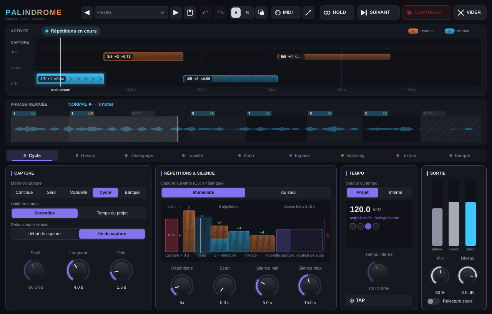
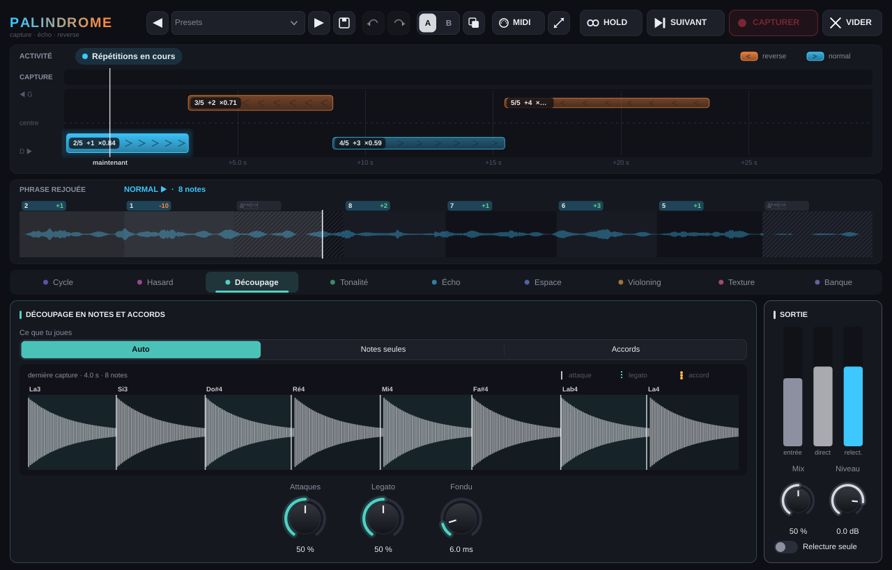
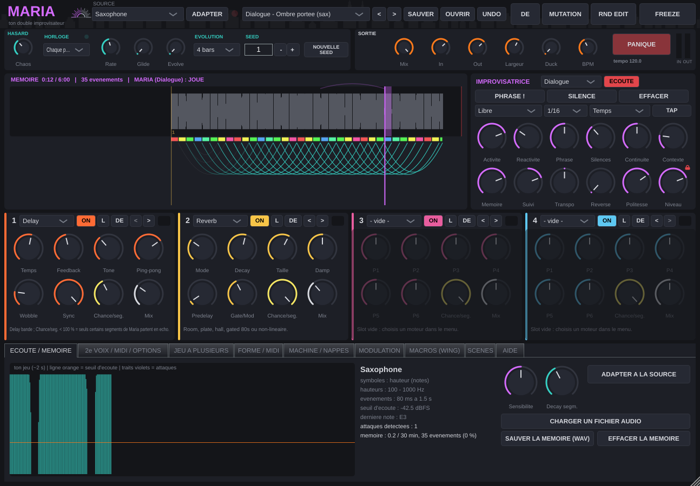
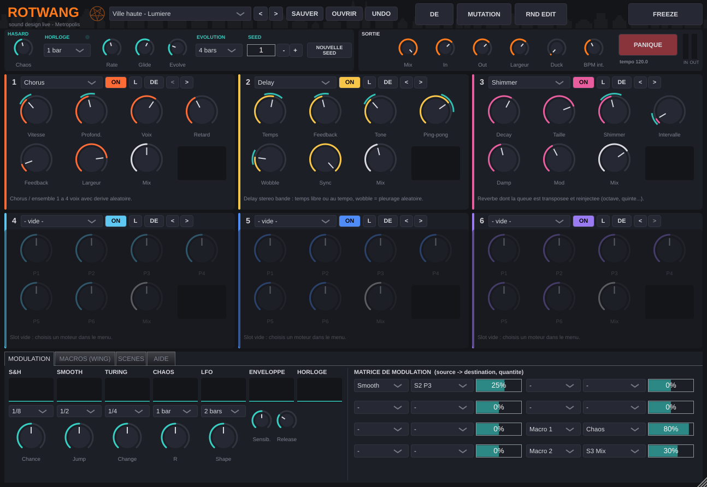
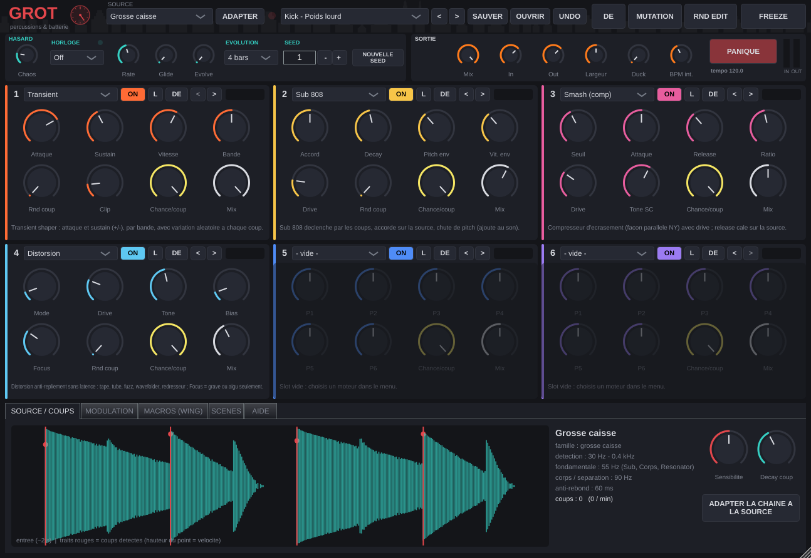
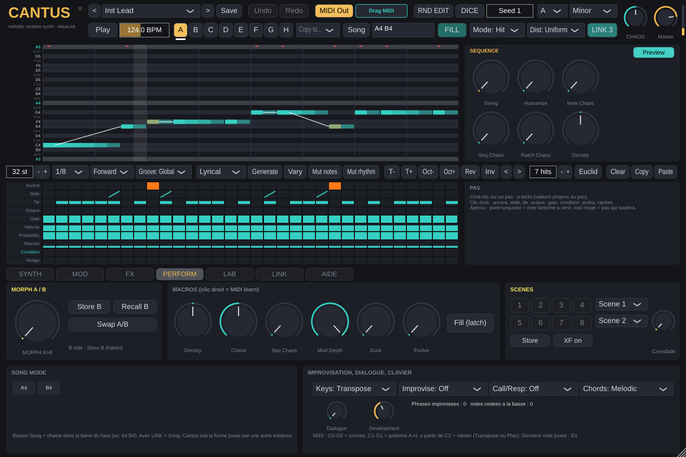
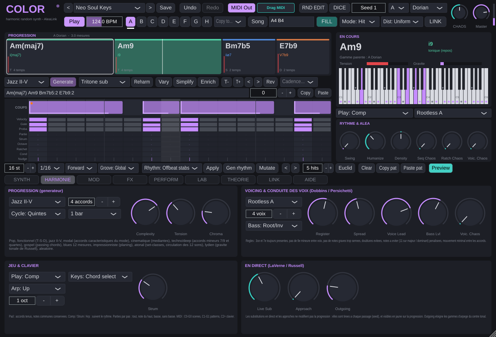
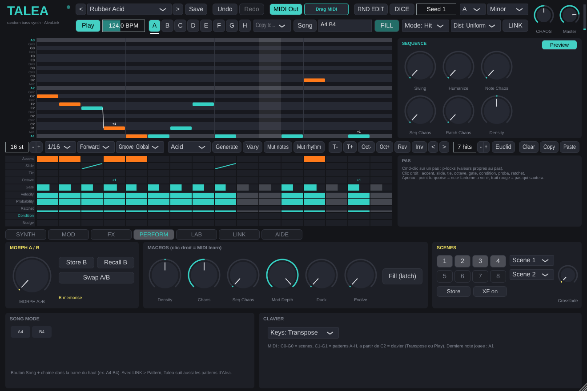

# Plugins audio d'Antony Soler

Plugins audio et instruments virtuels (AU / VST3 / Standalone) écrits en C++ avec [JUCE 8](https://juce.com), pour la scène, le studio et le ciné-concert.

| Dossier | Plugins | Type | Description |
|---|---|---|---|
| [Palindrome](Palindrome/) | Palindrome, Palindrome MIDI | Effet | Capture une phrase jouée et la rejoue en différé : reverse / normal, ordre des notes au hasard, gammes, écho façon Memory Man, banque de captures, découpage legato et accords, MIDI learn. |
| [FRAGOR](FRAGOR/) | Fragor | Instrument | Synthé de sound design dubstep : wobbles, growls, riddim, reese… wavetables, LFO dessinés, chaîne d'effets libre, MPE. |
| [MetropolisTrilogie](MetropolisTrilogie/) | Maria, Rotwang, Grot | Effets | Trilogie pour ciné-concert improvisé sur *Metropolis* : partenaire d'improvisation façon OMax (Maria), sound design de textures (Rotwang) et de percussions (Grot). |
| [Metropolis](Metropolis/) | Metropolis | Effet | Premier plugin de sound design pour batterie et percussions : moteurs Impact, Resonator, Reverse, Grain, Stutter. |
| [AleaSuite](AleaSuite/) | Alea, Talea, Color, Cantus | Instruments | Suite générative synchronisée (AleaLink) : percussions, basse, harmonie et mélodie qui jouent ensemble ; démos audio dans `AleaSuite/demos`. |

## Aperçu

| Palindrome | Palindrome : découpage en notes |
|---|---|
|  |  |
| **Maria** | **Rotwang** |
|  |  |
| **Grot** | **Cantus** (suite Alea) |
|  |  |
| **Color** (suite Alea) | **Talea** (suite Alea) |
|  |  |

## Installer (Mac Apple Silicon)

Chaque dossier contient un sous-dossier `binaires/` avec les plugins compilés (.zip). Sur GitHub : clique sur un .zip, puis sur *Download raw file*.

1. Dézippe, puis copie les `.component` dans `~/Library/Audio/Plug-Ins/Components` et les `.vst3` dans `~/Library/Audio/Plug-Ins/VST3`.
2. Les plugins ne sont pas signés par Apple : dans le Terminal, lance
   ```bash
   xattr -dr com.apple.quarantine ~/Library/Audio/Plug-Ins/Components ~/Library/Audio/Plug-Ins/VST3
   ```
3. Relance ton logiciel (dans Live : *Réglages → Plug-ins → Rescanner*).

## Compiler

La suite Alea est aussi compilée automatiquement par GitHub (onglet *Actions*) pour macOS et Windows, avec ses bancs de test.


Chaque plugin a son propre projet CMake ; voir le README de chaque dossier. Prérequis : Xcode Command Line Tools et CMake 3.22+. JUCE est téléchargé automatiquement quand aucun chemin local n'est donné.

## Licence

GPLv3 (voir [LICENSE](LICENSE)), compatible avec la licence gratuite de JUCE.
